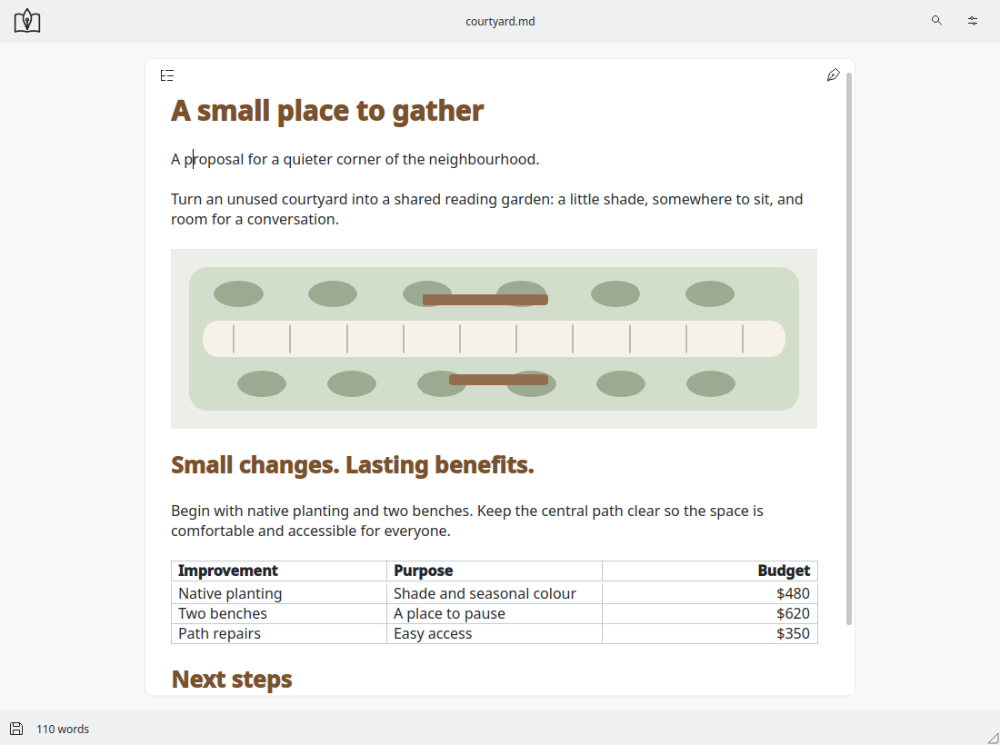

# Plainwright

### Markdown without the machinery.

A calm, native KDE editor for writing, shaping and sharing ordinary Markdown
documents. Work in the document—not beside a preview of it. Formatting reveals
itself when you need to edit it, then gets out of the way.

[**Download Plainwright**](https://github.com/UglyEgg/Plainwright/releases/latest)
 · [Installation](docs/INSTALL.md)
 · [Report a problem](https://github.com/UglyEgg/Plainwright/issues/new?template=bug_report.yml)

**1.0.1 is available:**
[RPM](https://github.com/UglyEgg/Plainwright/releases/download/v1.0.1/plainwright-1.0.1-1.fc44.x86_64.rpm)
 · [DEB](https://github.com/UglyEgg/Plainwright/releases/download/v1.0.1/plainwright_1.0.1-1ubuntu26.04.1_amd64.deb)
 · [Flatpak](https://github.com/UglyEgg/Plainwright/releases/download/v1.0.1/plainwright-1.0.1.flatpak)
 · [AppImage](https://github.com/UglyEgg/Plainwright/releases/download/v1.0.1/Plainwright-1.0.1-x86_64.AppImage)

Ubuntu users: choose **1.0.1 or later**, which repairs a directory-permission
defect in the original 1.0.0 DEB. See the release notes before installing.

## Write first. Go deeper when you need to.

- **One writing surface.** Read and edit formatted text in place. The Markdown
  source is always reachable; it remains your document's source of truth.
- **Useful document tools.** Work with headings, lists, tables and links through
  contextual controls, without keeping Markdown punctuation straight in your head.
- **Images that belong in the document.** Insert local images, describe them and
  resize them by dragging. Assets stay alongside ordinary files.
- **Equations and diagrams.** Build or edit math and Mermaid diagrams with
  focused tools, offline previews and editable source.
- **A document ready to share.** Preview and export PDF with tables, images,
  equations and diagrams—not just a printout of raw syntax.
- **A native KDE home.** Desktop fonts and colors, spell checking, file dialogs
  and Markdown file associations. No account is required for local editing.

Advanced features appear where they are useful. They do not need a permanent
toolbar, project rail or split preview to be available.

## Choose your package

Download the format listed for your system in the
[latest release](https://github.com/UglyEgg/Plainwright/releases/latest).
The release notes are authoritative for available files and runtime requirements.

| Format | Intended use |
| --- | --- |
| RPM | Native package for Fedora 44, x86_64. |
| DEB | Native package for Ubuntu 26.04, amd64—not a generic Debian/older Ubuntu package. |
| Flatpak | Standalone bundle using the KDE 6.11 runtime. Not a Flathub listing. |
| AppImage | Portable x86_64 build; Ubuntu 26.04 / glibc 2.43 baseline. |

An AppImage is not a promise of compatibility with every Linux distribution.
Do not install an RPM or DEB built for a different operating-system baseline.
See [installation and checksum verification](docs/INSTALL.md).

## Your files stay ordinary

Plainwright writes Markdown files, not a proprietary document database. Optional
presentation hints for supported rich content may be interpreted differently by
other readers. Plainwright keeps the editable source and provides its own PDF
output; identical rendering in every Markdown application is not promised.

## Free to use, with clear licensing

Official Plainwright releases are free to use under the included proprietary
license. **Free to use does not mean open source.** Original Plainwright,
Markdown Editor Core and Stillform source is private and separately licensed.
Third-party components retain their own licenses and rights.

This repository distributes official binaries, notices, checksums and required
third-party source material. A GitHub-generated “Source code” archive is a snapshot
of this distribution repository, not the private application source. Use the
explicitly named notices and third-party source assets supplied with each release.
Complete terms are also available in **About → Licensing** in the application.

## Help make it better

Found a rough edge? [Open an issue](https://github.com/UglyEgg/Plainwright/issues/new/choose)
with the package format, version, desktop and steps to reproduce it. A small,
sanitized example is more useful than a private document.

See [support and troubleshooting](SUPPORT.md). Please do not post credentials,
recovery data or sensitive document contents in public issues.

Maintainer: **Rich Majewski** · [pwdev@entropy.quest](mailto:pwdev@entropy.quest)
